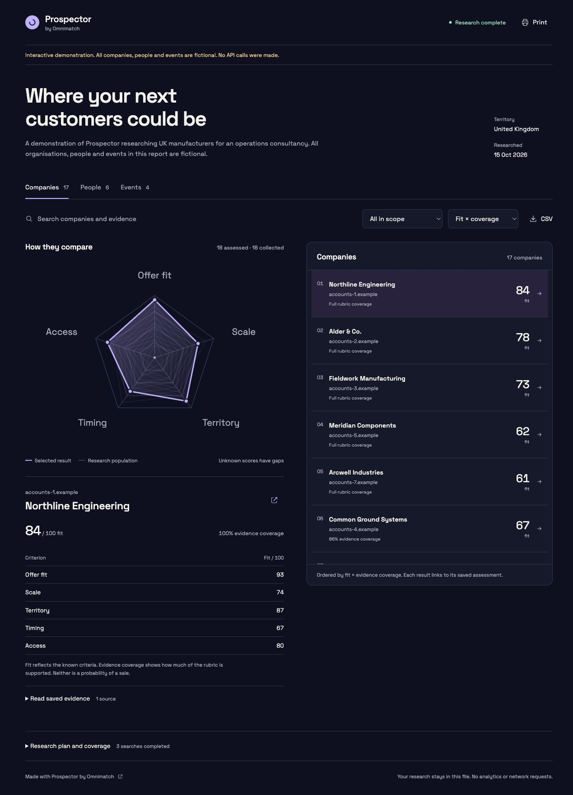

# Omnimatch skills

Free agent recipes from [Omnimatch](https://omnimatch.ai). Run them in your own file-capable agent, with your own API keys. No Omnimatch account, databases, hosted app or MCP server is required.

| Skill | What it does | Install |
| --- | --- | --- |
| [Prospector](skills/prospector/SKILL.md) | Find potential customers, relevant people and useful events | `npx skills add omnimatch/skills --skill prospector` |
| [Job Scout](skills/job-scout/SKILL.md) | Find jobs, research routes into employers and track applications locally | `npx skills add omnimatch/skills --skill job-scout` |
| [Recruiter](skills/recruiter/SKILL.md) | Compare public professional evidence against a hiring brief for human review | `npx skills add omnimatch/skills --skill recruiter` |
| [Day Tripper](skills/day-tripper/SKILL.md) | Find ideas and build a dated day plan with an itinerary and sourced route sketch | `npx skills add omnimatch/skills --skill day-tripper` |

Then ask your agent to use the installed skill, guide setup and research your request. The first conversation brings together provider setup, your brief and a run budget. Keys go into a private terminal or your secret manager, never chat.



## What you need

Node 22+ (24 recommended), Exa search and your choice of OpenAI Decisions or Cloudflare Clef. The recipes are free; API use is billed by those providers. An existing assistant subscription does not automatically provide API entitlement.

Each installed skill includes its own runner and prebuilt React report. Recipients do not run npm install or compile the interface. Codex and Claude Code can run the scripts where command execution and files are available. A ChatGPT session needs those capabilities; a chat-only session cannot execute a local skill.

Prefer the host's supported interactive artifact or visualization surface. Preview support varies, so every run also produces a self-contained HTML file that opens in a browser without a server. It contains the radar, scrollable results, search, filters, criterion scores, saved evidence, CSV and print output. Day Tripper can add a timed itinerary and schematic route from sourced coordinates.

## Try a report without keys

After cloning or downloading the repository:

```sh
node skills/prospector/scripts/prospector.mjs demo --out ./demo-output
node skills/job-scout/scripts/job-scout.mjs demo --out ./job-demo
node skills/recruiter/scripts/recruiter.mjs demo --out ./recruiter-demo
node skills/day-tripper/scripts/day-tripper.mjs demo --out ./trip-demo
```

Open the chosen directory's `report.html`. All demonstration records are fictional; the Day Tripper coordinates are synthetic. These commands make no API requests.

## Research that stays explorable

Each skill guides a brief, plans separate source collections, saves evidence and assesses results against a consistent rubric. Missing facts stay unknown. Checkpoints preserve completed work, conservative request ceilings keep spending decisions visible, and failed or lost requests require explicit paid retries. Follow-up questions read saved evidence before starting fresh discovery.

The initial collector deduplicates exact canonical URLs. Different pages about one company, person, vacancy or venue can remain separate. Event hits are listing pages until occurrence details are verified. Scores describe fit to a brief and support human review; they are not calibrated outcome probabilities. Local request ceilings are estimates; provider account spending limits remain the final billing boundary.

No skill automatically sends outreach, applies for jobs, makes hiring decisions, books a trip or schedules recurring work. The host assistant follows the user's current instructions and checks current primary sources for consequential practical details. Research queries and evidence go to the selected providers; checkpoints and reports stay local. There is no Omnimatch telemetry.

## Grok Bot templates

Use the [Grok Bot guide](templates/grok/README.md) for Prospector and the companion recipes for [Job Scout](templates/grok/job-scout/README.md), [Recruiter](templates/grok/recruiter/README.md) and [Day Tripper](templates/grok/day-tripper/README.md). Each template bootstraps public code on the recipient bot's own computer and uses that person's keys. Custom scripts and private computer state do not transfer with a native template. An openable browser report is preserved when embedded chat rendering is unavailable.

## Develop

The runtime uses Node built-ins. React, esbuild and Biome are development dependencies for the already shipped report. The Prospector runner is the common source; `scripts/sync-skills.mjs` copies its runtime and shared references into each separately installable folder. Domain instructions stay in the individual SKILL.md files, with plans and fictional demos in `catalogue/skills.mjs`. Edit the source, then regenerate rather than patching generated runtime copies.

```sh
npm ci
npm run build:report
npm run lint
npm test
```

CI checks that regeneration leaves all skill files unchanged. See [validation and compatibility](docs/VALIDATION.md) for checked paths and limits. Tests use synthetic fixtures and mocked responses, with no API keys. Keep credentials, CVs, hiring briefs, private profiles and real research outside the public checkout. Every installed skill must remain self-contained.

These are independently published skills; no official platform endorsement is implied. Bug reports and contributions are welcome through GitHub issues and pull requests. Original code and instructions are MIT licensed. React and the embedded font retain their own notices; see [LICENSE](LICENSE) and [THIRD_PARTY_NOTICES.md](THIRD_PARTY_NOTICES.md).
