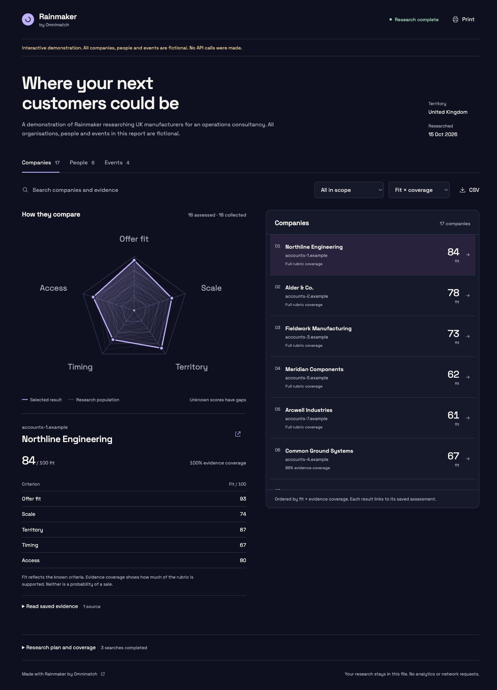

# Omnimatch skills

Free agent recipes from [Omnimatch](https://omnimatch.ai). Run them in your own agent, with your own API keys. No Omnimatch account, hosted app or MCP server is required.

## Rainmaker

Find and prioritise target companies, relevant people and credible routes to approach. Rainmaker plans the research, collects evidence, assesses each result against a rubric and creates an interactive radar report with searchable results and source evidence.



```sh
npx skills add omnimatch/skills --skill rainmaker
```

Then ask your agent:

> Use Rainmaker. Help me set it up, then find companies that could buy my services and create an interactive research report.

The first conversation guides provider setup and the research brief. You need Node 22+ (24 recommended), Exa search and your choice of OpenAI Decisions or Cloudflare Clef. API use is billed by those providers; the skill is free. Keys stay in your environment or private local configuration. The setup wizard hides key input and never asks for keys in chat.

The installed skill includes its runner and prebuilt React report. End users do not run npm install or compile the interface. File-capable agents such as Codex and Claude Code can run it; embedded previews depend on the host. The self-contained HTML report also opens in a browser without a server. ChatGPT sessions need command execution and files; chat-only environments cannot run a local skill.

## Try it without API keys

After cloning or downloading this repository:

```sh
node skills/rainmaker/scripts/rainmaker.mjs demo --out ./demo-output
```

Open `demo-output/report.html`. Everything in the demonstration is fictional. No API requests are made. Select a result to change the radar, switch collections, search evidence, filter results and open the source passages.

## What is included

- Guided first-use setup and private local credentials.
- Separate company, people, news and event-source research.
- Explicit scoring criteria, evidence sufficiency and preserved unknowns.
- Canonical-URL deduplication, source text and search provenance.
- Checkpoints, conservative request budgets and explicit paid retries.
- An offline React report with radar comparison, scrollable results, search, filtering, evidence, CSV and print output.
- A [Grok Bot companion template](templates/grok/README.md) using the same skill and report.

This initial release deduplicates exact canonical URLs, not every legal entity across different websites. Event hits are listing pages until occurrence details are verified. Provider scores are model assessments, not calibrated probabilities of a sale. The local cost ceiling reserves conservative request estimates; provider account spending limits remain the final billing boundary.

## Develop

The scripts use Node built-ins and have no runtime dependencies. React and esbuild are development dependencies for rebuilding the already shipped report asset.

```sh
npm ci
npm run build:report
npm test
```

Tests use synthetic fixtures and mocked provider responses. They require no API keys. Do not commit credentials, real prospect research, user profiles or run directories. Keep installed skill dependencies inside `skills/rainmaker/` so an individual skill installation remains self-contained.

See [validation and compatibility](docs/VALIDATION.md) for the checked paths and current limits. This is an independently published skill; no official platform endorsement is implied.

See [Rainmaker's workflow](skills/rainmaker/references/workflow.md) and [setup guide](skills/rainmaker/references/setup.md) for operational details. Bug reports and contributions are welcome through GitHub issues and pull requests.

## Licence

Original code and instructions are MIT licensed. React's bundled runtime retains its MIT notices. See [LICENSE](LICENSE) and [THIRD_PARTY_NOTICES.md](THIRD_PARTY_NOTICES.md).
