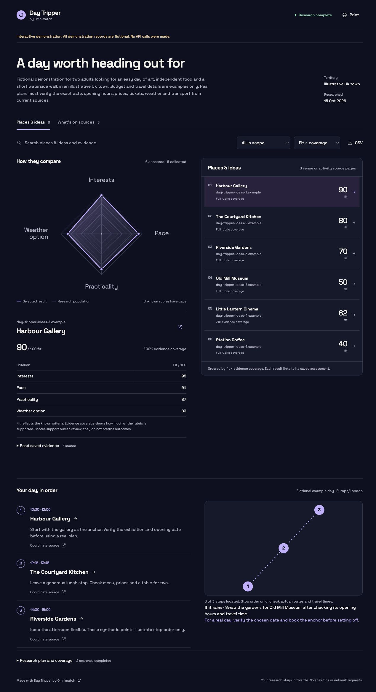

# Example reports

The [v0.3.0 release](https://github.com/omnimatch/skills/releases/tag/v0.3.0) includes four downloadable HTML demonstrations. All data is fictional and no API calls are made. Day Tripper's coordinates are synthetic illustration points.

- [Prospector demo](https://github.com/omnimatch/skills/releases/download/v0.3.0/prospector-demo.html)
- [Job Scout demo](https://github.com/omnimatch/skills/releases/download/v0.3.0/job-scout-demo.html)
- [Recruiter demo](https://github.com/omnimatch/skills/releases/download/v0.3.0/recruiter-demo.html)
- [Day Tripper demo](https://github.com/omnimatch/skills/releases/download/v0.3.0/day-tripper-demo.html)

Download and open a file in a browser. It contains the complete React interface, font, saved evidence and demo data. No server or keys are needed. Interactive previews inside an assistant depend on that host's available tools.

